<p align="center"></p>
<h1 align="center">A clearer way to care.</h1>
<p align="center">A multi-tenant support workspace built with Angular, ASP.NET Core and SQL Server.<br>Thoughtful interfaces. Real workflows. Explicit security boundaries.</p>
<p align="center"><a href="#run-it-locally">Get started</a> · <a href="docs/ARCHITECTURE.md">Architecture</a> · <a href="docs/API.md">API contract</a> · <a href="docs/VERIFICATION.md">Verification evidence</a></p>

---

**Avenor** brings customer conversations, ownership, deadlines and team operations into one calm workspace. Its name evokes an avenue forward: a clear path from a customer's question to a helpful answer. Northstar Studio and Meridian are explicitly seeded demonstration organizations; the application uses a real relational API throughout.

## The workspace

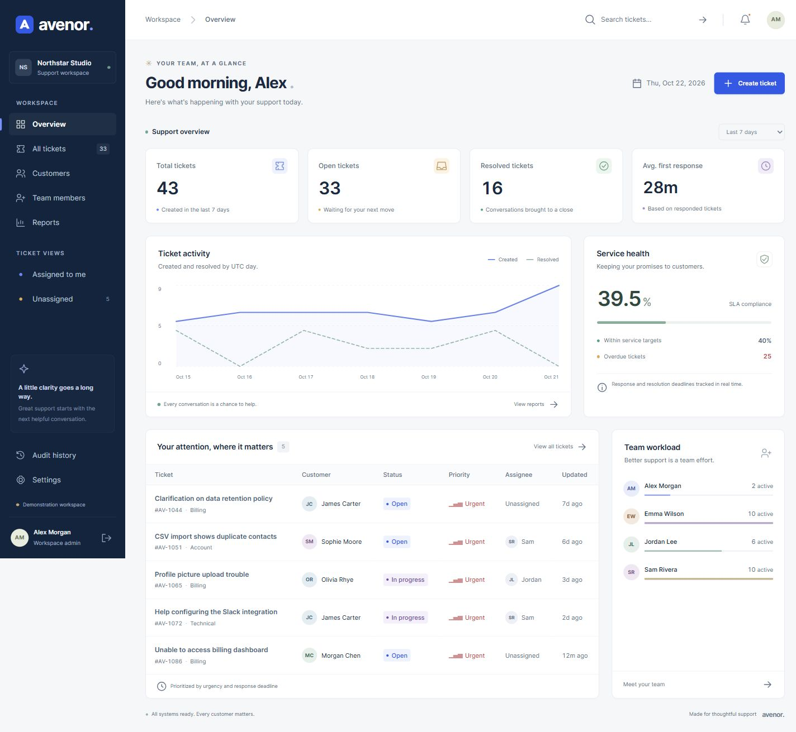

All screenshots below were captured from the running Angular application connected to the real API and relational demonstration database.

| Sign in | Ticket queue |
|---|---|
| 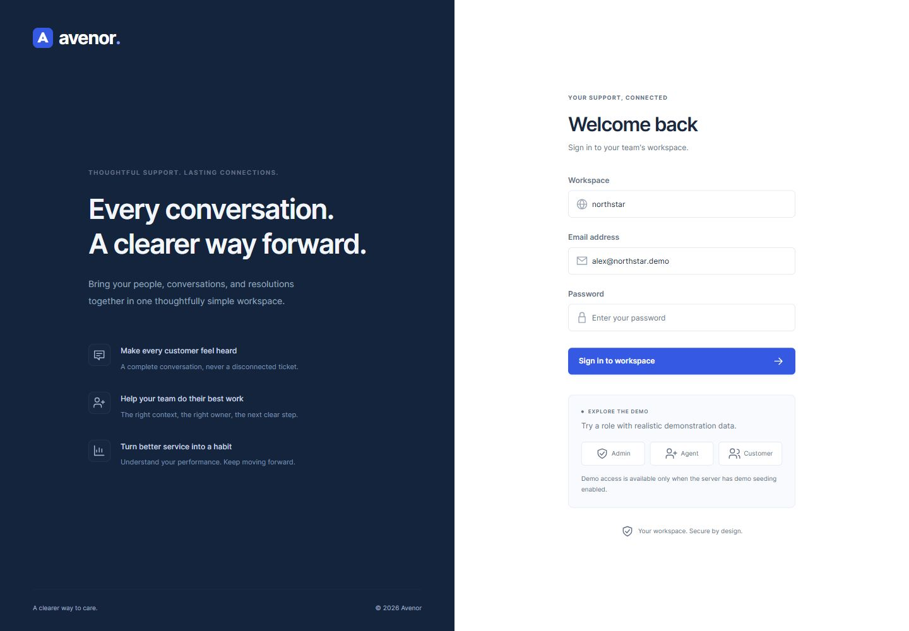 | 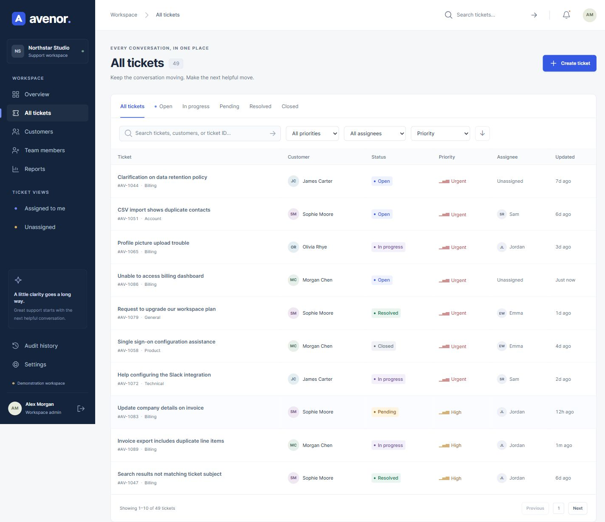 |
| **Conversation and ownership** | **Administration and SLA policies** |
| 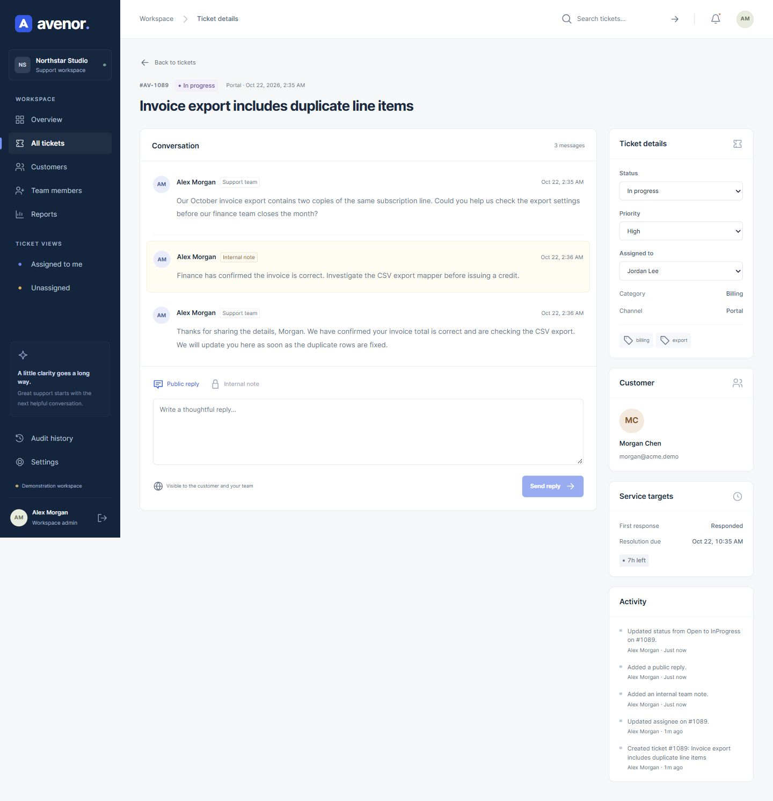 | 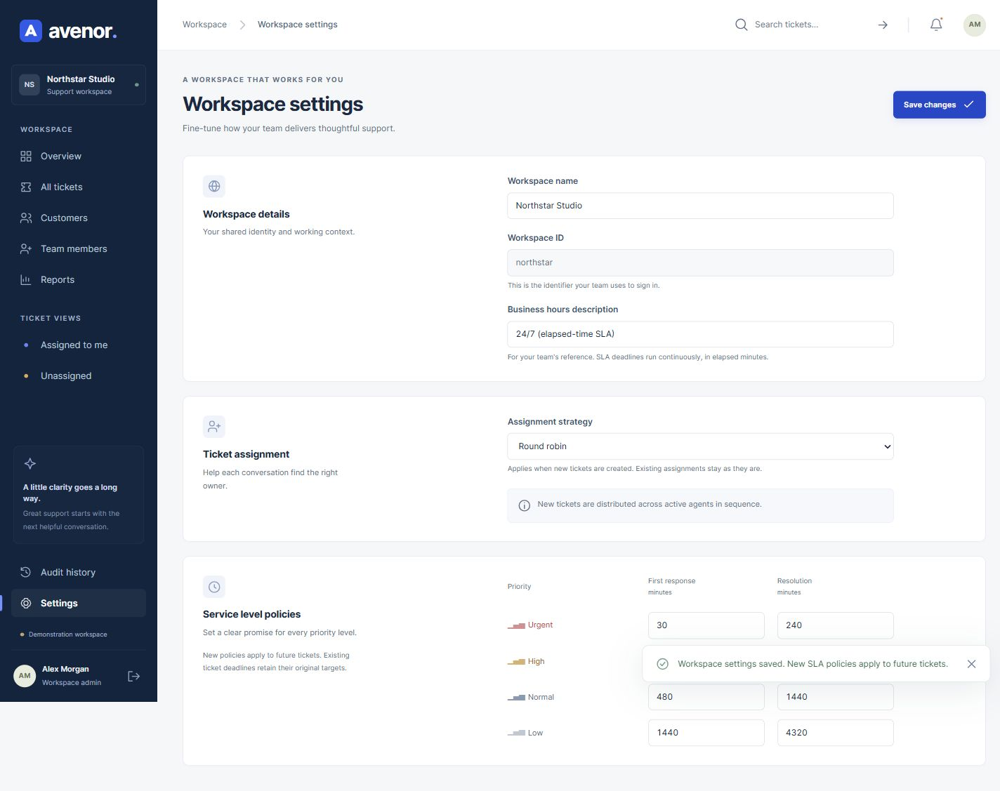 |
| **Reports** | **Customer portal** |
| 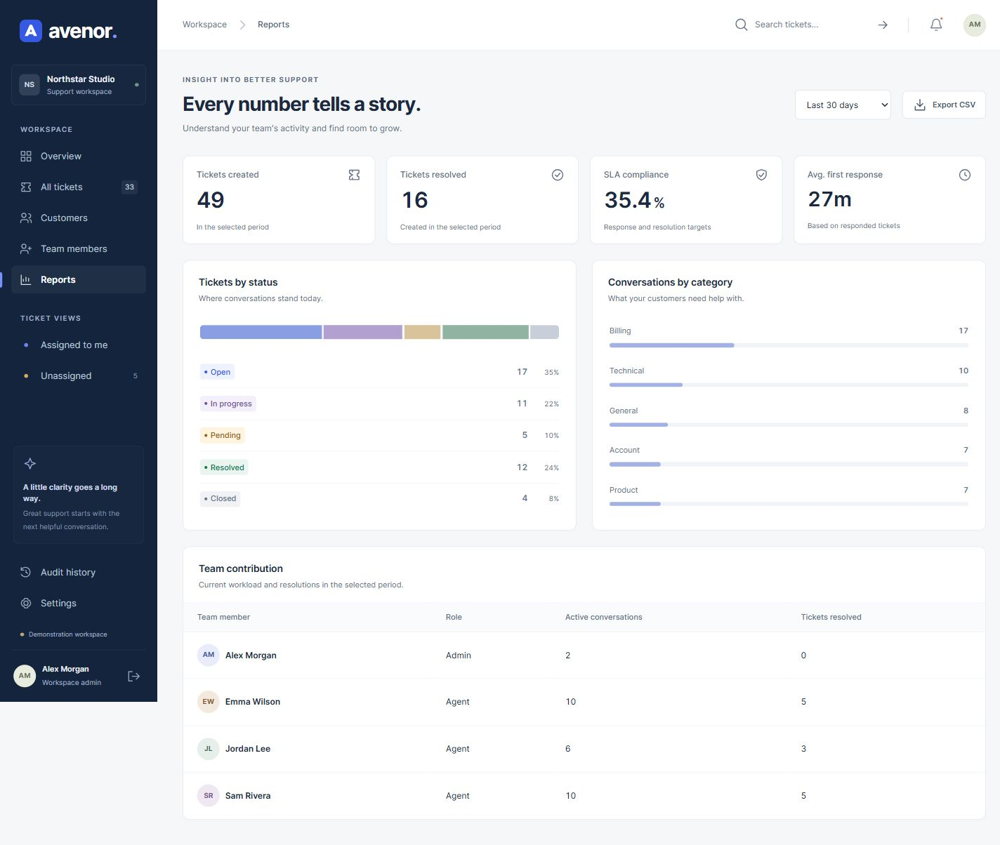 | 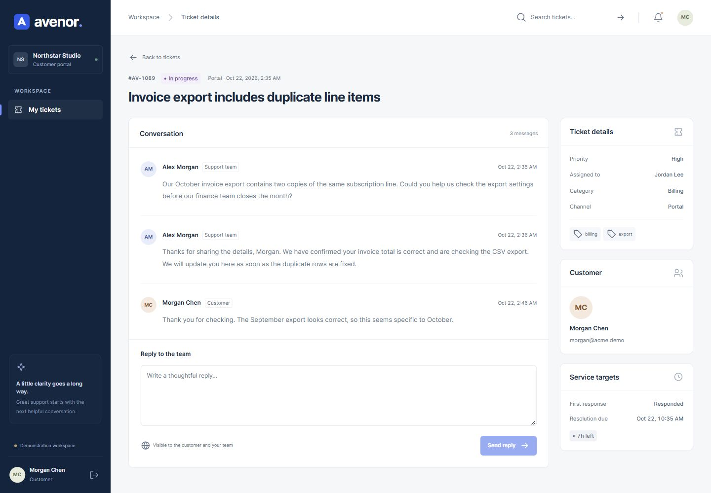 |

### Small details, complete workflows

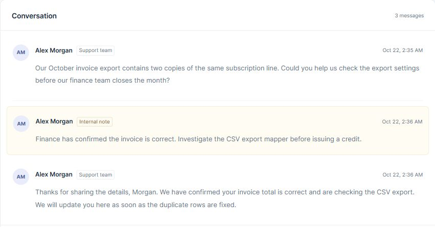

**Public replies and private context.** Staff can keep investigation notes alongside the conversation. Customer sessions receive only public messages; ownership and privacy are enforced by the API.

<details>
<summary>Ticket creation and mobile layout</summary>

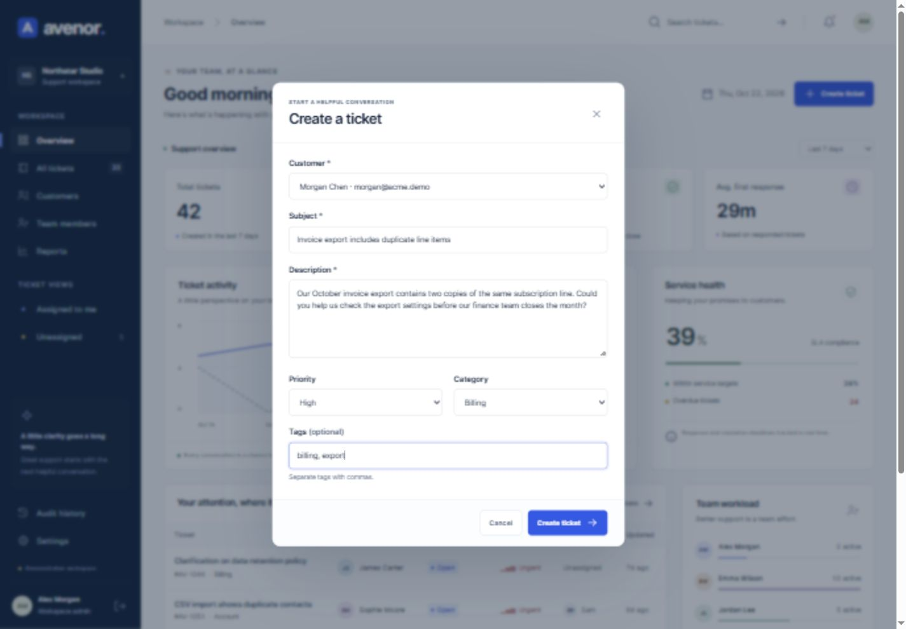

The creation form validates real customer references and required fields. Assignment and SLA deadlines come from workspace policies. On narrow screens, the navigation becomes a drawer, panels stack, and tables scroll inside their own container.

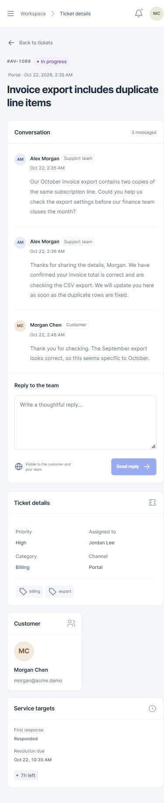

</details>

## What you can do

| Experience | Connected functionality |
|---|---|
| Support workspace | Search, filter, sort and paginate tickets; create requests; assign an owner; change priority and status; manage public replies and internal notes. |
| Customer portal | Create and follow your own requests, reply to agents and reopen a resolved conversation. Internal staff notes stay private. |
| Team operations | Compare real ticket volume, resolution and response metrics; inspect workload; export CSV reports; track SLA risk and escalations. |
| Administration | Create users, manage roles and account status, configure assignment and SLA policies, review immutable audit history. |
| Live updates | Authenticated, tenant-scoped server-sent events refresh the workspace after relevant changes. Notifications link back to the ticket. |

Ticket transitions are explicit and validated. Updates carry a version number: concurrent edits return a conflict instead of silently overwriting another agent's work. Assignment supports manual, least-busy and round-robin strategies. SLA deadlines use elapsed UTC time; business hours are displayed as information, not a working-hours calculation.

## A considered design system

Deep navy anchors the navigation, cobalt identifies actions, and warm white surfaces keep the work readable. The geometric avenue mark, quiet line icons, tabular metrics and restrained semantic colors form a coherent identity. Fonts use a system stack, so the application works without a third-party font request.

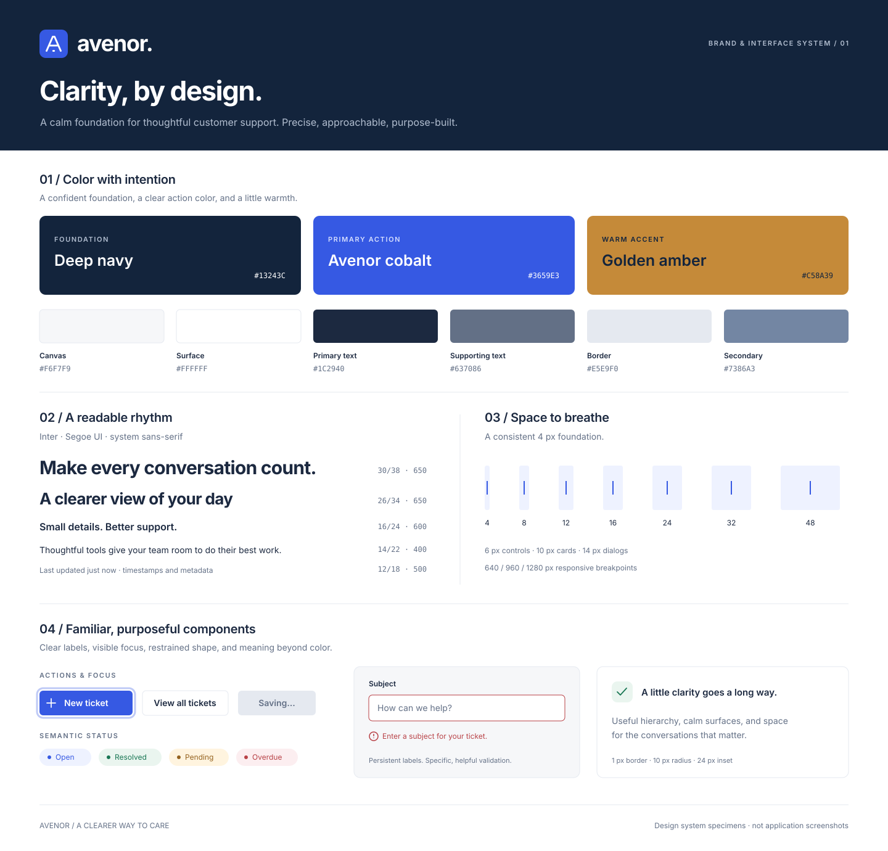

The showcase contains design specimens. Read the [actual tokens, interaction states and accessibility conventions](docs/DESIGN_SYSTEM.md).

## How it is built

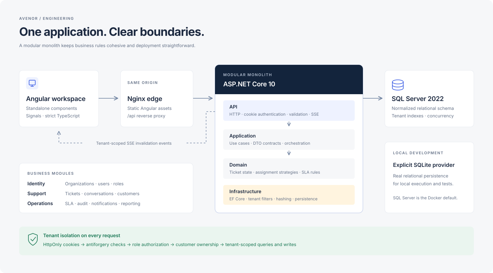

The system is a **modular monolith**. Angular talks to the API through a same-origin proxy. Domain rules express ticket transitions, deadlines and assignment decisions; application contracts define the boundary; infrastructure owns EF Core persistence; the API handles HTTP, authentication and authorization. A single relational transaction keeps a ticket, its conversation, audit entry and notification consistent.

| Technology | Role |
|---|---|
| Angular 21, TypeScript 5.9, RxJS 7 | Standalone components, signals, typed API integration, accessible responsive UI |
| .NET 10 / ASP.NET Core | Cookie authentication, validation, role policies, REST endpoints and SSE |
| Entity Framework Core 10 | Relational model, tenant filters, indexes, foreign keys and migrations |
| Microsoft SQL Server 2022 | Docker deployment database |
| SQLite | Explicit local development and relational test provider |
| Docker Compose, Nginx | Reproducible service topology and same-origin routing |
| xUnit, ASP.NET integration testing, Node test runner | Domain, database/security integration and frontend business-rule tests |

Angular 21 is a supported LTS line and works with Node 24 / TypeScript 5.9 ([Angular compatibility](https://angular.dev/reference/versions)). .NET 10 is an LTS release ([Microsoft support policy](https://dotnet.microsoft.com/en-us/platform/support/policy/dotnet-core)). Exact resolved dependency versions are committed in the lockfile/project files.

### Engineering decisions

- **Isolation at more than one layer.** Authenticated claims select the tenant; EF global filters scope reads; write checks reject tenant changes; composite foreign keys prevent references across organizations. Customers additionally receive ownership-filtered tickets and public messages only.
- **Browser sessions with CSRF protection.** Authentication uses HttpOnly cookies, ASP.NET password hashing and rate-limited login. Every mutation requires the antiforgery token, including login and logout. Production cookies require HTTPS.
- **Patterns where they help.** A small state-transition rule centralizes valid ticket changes. Assignment strategies share one decision function. No speculative service mesh, event broker or generic repository obscures EF's unit of work.
- **Consistency over silent overwrites.** Optimistic version checks guard ticket edits; audit records accompany business mutations. Tenant/status/date indexes support queues and reporting.
- **Progressive operational scale.** SQL Server is the deployment provider. SSE delivery is in-process; multiple API replicas would need shared invalidation infrastructure. Reporting is intended for portfolio/demo-scale data; further aggregation belongs behind measured demand.

See [architecture, schema and milestones](docs/ARCHITECTURE.md) and the [HTTP contract](docs/API.md).

## Run it locally

### Docker + SQL Server

Requires Docker Desktop with a running Linux engine, Docker Compose and sufficient memory for SQL Server (at least 2 GB for SQL Server; 4–6 GB for the complete stack is practical).

```powershell
Copy-Item .env.example .env
# Set a unique MSSQL_SA_PASSWORD in .env before starting.
docker compose up --build -d
```

Open **http://localhost:8080**. The API applies the tracked SQL Server migration and, because this is an explicit local demo, seeds two organizations on an empty database. SQL Server is reachable only on the private Compose network; the web port is bound to loopback.

```powershell
docker compose logs -f api
docker compose down
```

The named `sql-data` volume persists data across restarts. This Compose file deliberately runs a local HTTP demonstration with `SeedDemo=true`. For a real deployment, terminate TLS, use Production, disable demonstration seeding, configure least-privileged SQL credentials, persist data-protection keys and provide backups/monitoring. See [SECURITY.md](SECURITY.md).

### Native development + SQLite

Requires Node 24, npm, .NET 10 SDK and Python 3 only for the optional HTTP smoke test. PowerShell 7 is recommended.

```powershell
./scripts/dev.ps1
# Subsequent starts can skip installation:
./scripts/dev.ps1 -NoInstall
```

Open **http://localhost:4200**. The script explicitly selects SQLite and creates `.local/avenor.db`; the production SQL Server provider is never silently replaced. API output is in `.local/api.log`. Ctrl+C stops the servers. For separate terminals, use the same environment values shown in [scripts/dev.ps1](scripts/dev.ps1), then run `dotnet run --project backend/Avenor.Api` and `npm start` in `frontend`.

### Demonstration accounts

The demo password is **`AvenorDemo!2026`**. These accounts exist only when `SeedDemo=true`.

| Organization | Email | Role |
|---|---|---|
| `northstar` | `alex@northstar.demo` | Administrator |
| `northstar` | `jordan@northstar.demo` | Support agent |
| `northstar` | `morgan@acme.demo` | Customer |
| `meridian` | `admin@meridian.demo` | Separate tenant administrator |

## Verification

```powershell
./scripts/verify.ps1
# With the native application running:
python scripts/smoke.py http://localhost:4200
# Or exercise the actual SQL Server containers:
python scripts/smoke.py http://localhost:8080
```

**Verified locally:** 25 backend tests, 10 frontend tests, clean builds, zero reported npm/NuGet dependency vulnerabilities, and the HTTP smoke test through Angular's proxy. Browser checks covered admin/customer login, creation, assignment, replies, private-note exclusion, queue filters/pagination, settings, notifications, customer creation, reporting/CSV download and mobile layouts.

Tests focus on state transitions, assignment, relational constraints, session/CSRF behavior, roles, cross-tenant reads and writes, private notes, version conflicts, frontend validation and stale-response isolation. The HTTP smoke test creates one clearly labeled demonstration ticket and a deactivated test agent, then follows the ticket lifecycle through the real API. CI also defines a full SQL Server container integration job.

**Environment limit:** Docker's engine was unavailable. Compose configuration and migration/model synchronization pass, but SQL Server/container execution remains unverified. See [the verification record](docs/VERIFICATION.md). A CI definition is not a claim that CI has run.

## Repository map

```text
backend/
  Avenor.Domain/          Entities and business rules
  Avenor.Application/     Contracts, validation and tenant abstraction
  Avenor.Infrastructure/  EF model, migration, mapping and demo data
  Avenor.Api/             HTTP endpoints, sessions, events and composition
  Avenor.Tests/           Domain and relational API integration tests
frontend/                Angular application and frontend tests
deploy/                  Nginx configuration
scripts/                 Development, verification and HTTP smoke scripts
docs/                    Design, architecture, API and verification evidence
  assets/                Brand SVGs and genuine application screenshots
compose.yaml             Local SQL Server + API + web stack
```

For an empty non-demo database, use the [offline organization bootstrap command](docs/BOOTSTRAP.md). It creates the organization, first administrator, SLA policies and audit record; there is no public signup endpoint.

This implementation focuses on a complete support core. Email delivery/ingestion, file attachments, external SSO, billing, self-service organization signup, password recovery and multi-replica event delivery are outside the current scope. There are no decorative controls claiming those capabilities.

[MIT license](LICENSE).
