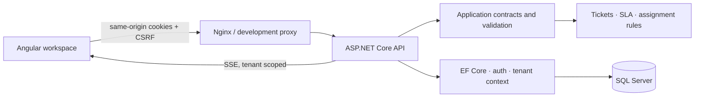

# Architecture and delivery plan

## Decisions

The requested stack is retained. Angular 21 (supported LTS), TypeScript 5.9, Node 24, ASP.NET Core / EF Core 10 (LTS), SQL Server 2022 and Docker Compose form a modular monolith. Compatibility references: https://angular.dev/reference/versions and https://dotnet.microsoft.com/en-us/platform/support/policy/dotnet-core. Versions are locked in project manifests/lockfiles. No microservices or message broker are needed for this workload.

## Modules and schema

Identity: organizations, users and roles (Admin, Agent, Customer). Support: tickets and messages. Operations: organization SLA/assignment settings, notifications and immutable audit entries. Tenant-owned records carry TenantId with scoped indexes and global query filters. Foreign references are validated within the active tenant. Ticket numbers are independent display identifiers; GUIDs identify resources. Messages distinguish public replies from internal notes. Ticket versions provide optimistic concurrency. Store UTC; format in the browser's locale.

State transitions: Open → InProgress/Pending/Resolved; InProgress → Open/Pending/Resolved; Pending → Open/InProgress/Resolved; Resolved → Open/Closed; Closed is terminal. A new customer reply reopens a resolved ticket. Closed tickets reject replies. First staff response and resolution timestamps feed SLA reporting. Priority-specific response and resolution deadlines are calculated when tickets are created. Escalation scans overdue unresolved tickets, creates a single notification/audit event, and marks them escalated. Assignment strategies: manual, least active tickets, round robin. User management prevents disabling/demoting the last active administrator.

## Security

HttpOnly SameSite authentication cookies; secure cookies outside local development; antiforgery header on all mutations including login; password hashing via ASP.NET; login rate limiting and generic failures; no tenant IDs from mutation bodies; API role checks and customer ownership checks; deny customer access to internal notes; validated lengths/enums; safe plain-text rendering; structured ProblemDetails; no production demo passwords or committed secrets. Browser SSE events carry only invalidation notifications and use the authenticated tenant. Production deployment still requires TLS termination, managed secrets, backups and operational monitoring.

## Milestones

1. Establish identity/tokens, architecture, API contract and conventions (this documentation).
2. Build domain rules, relational persistence/migrations, authentication and tenant isolation.
3. Build an integrated Angular workspace and full ticket lifecycle.
4. Connect reporting, customer/team management, SLA settings, notifications and audit history.
5. Build/test backend and frontend; run cross-tenant/role/concurrency tests and browser workflows.
6. Package Docker; capture genuine screenshots/design showcase; finish README and evidence log.

## Verification constraints discovered initially

.NET 10.0.401, Node 24.21.0 and npm 11.19.0 are installed. Docker CLI is installed but its engine is not running. Use an explicitly configured SQLite development database for local execution if the engine remains unavailable. Container/SQL Server execution must be reported separately from local build and relational integration tests.
